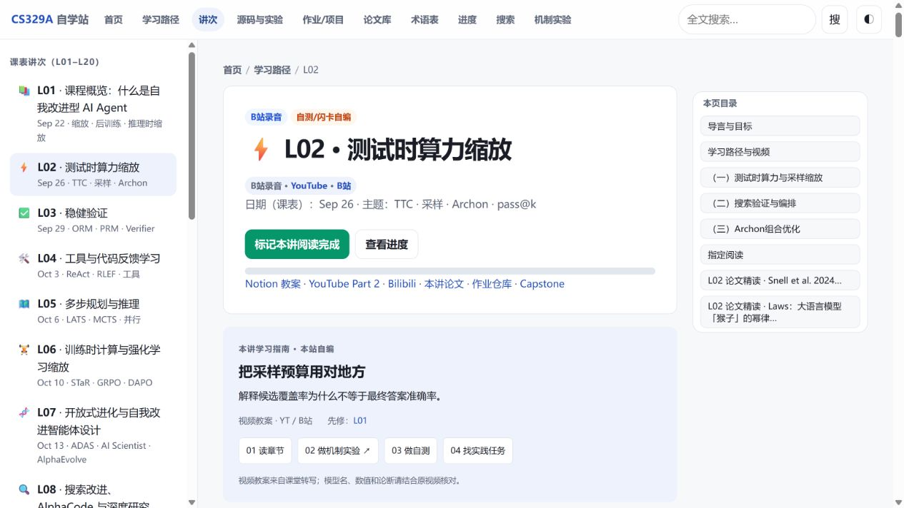
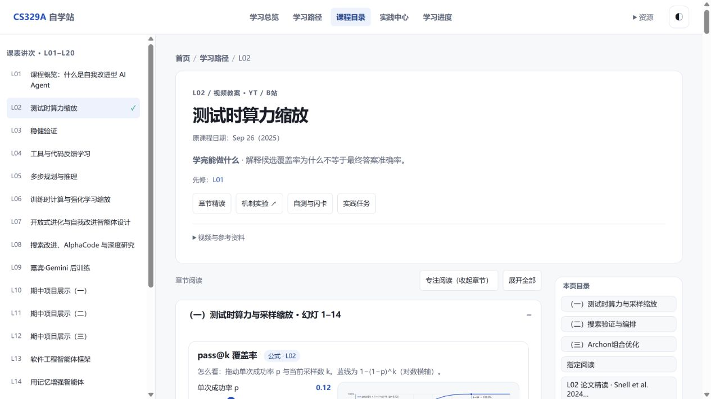
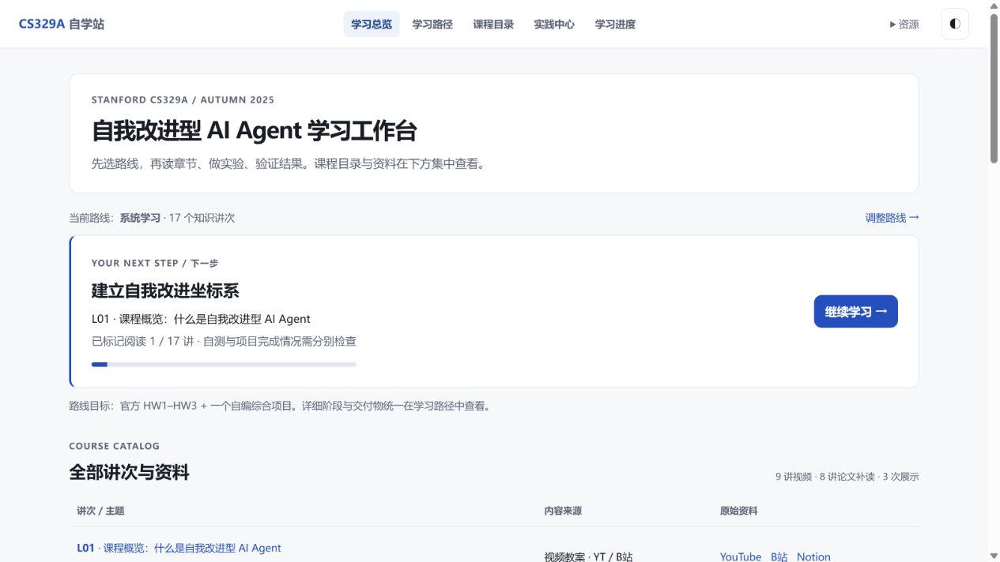
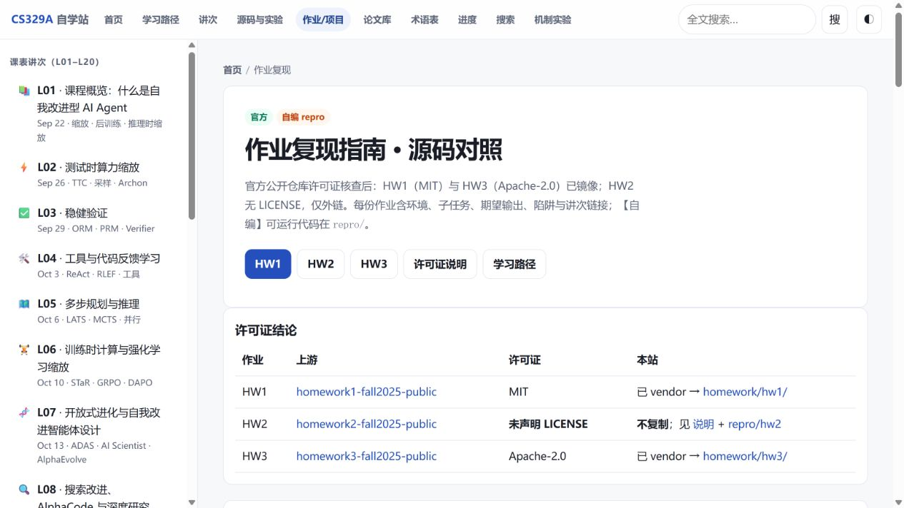
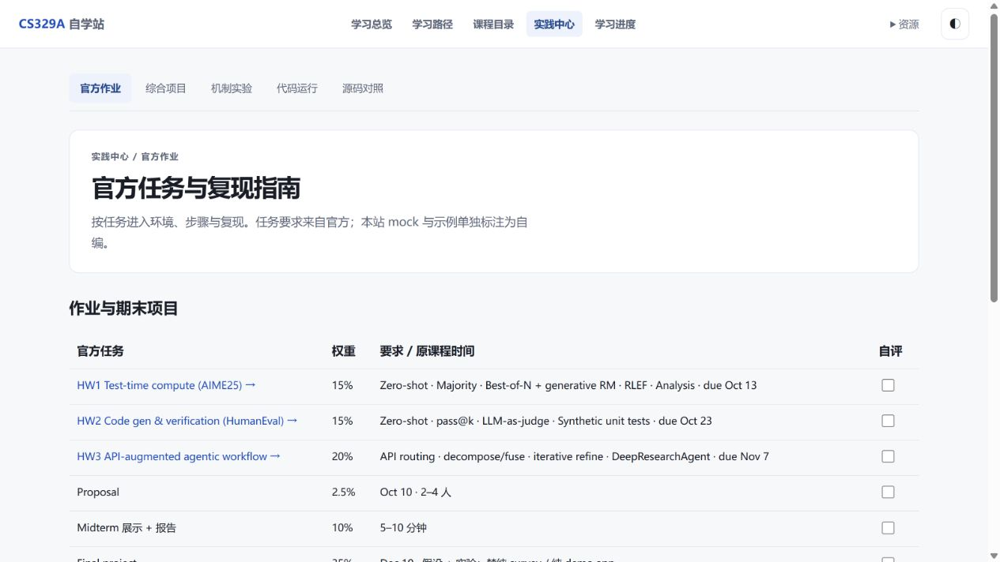
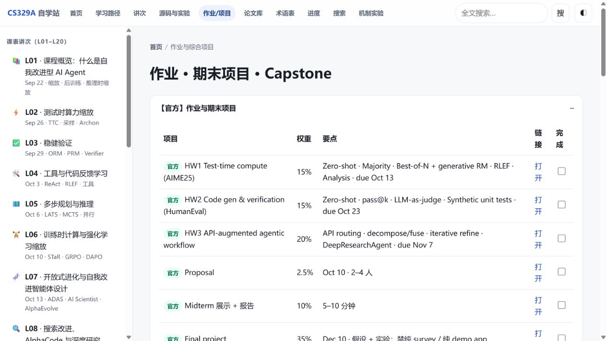
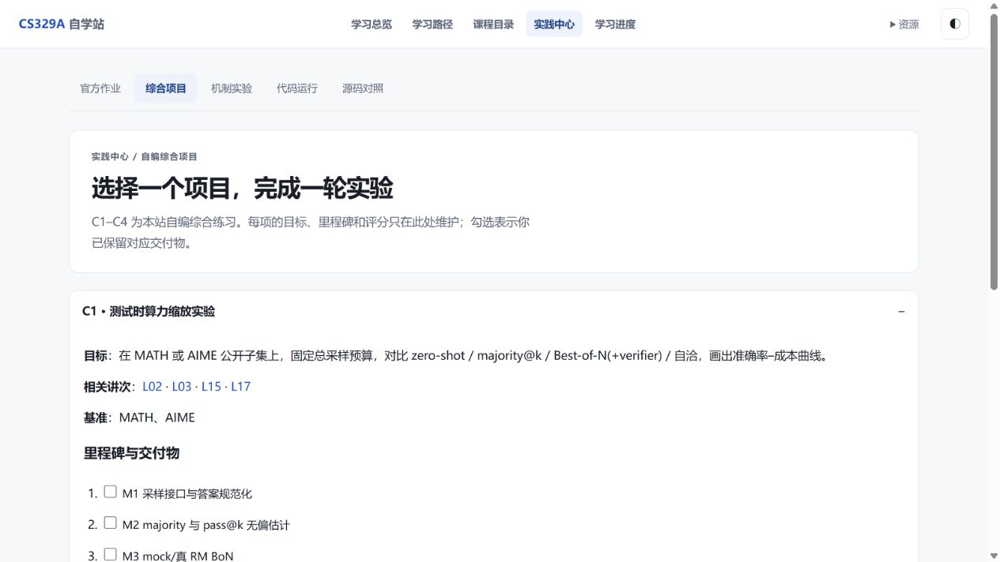

# 重复入口与整体布局整理

2026-11-05。对当前线上版本现场截图，再在同一浏览器、同一默认桌面视口验证修改。移动端另检查 390 × 844。以下为实现记录，非全面内容校对或无障碍认证。

## 范围与目标

让学习者找到下一步、进入章节、完成作业，不必在同一页面反复判断几个按钮是否指向同一功能。检查首页、学习路径、讲次、官方作业、综合项目、实验、代码、论文、术语、进度和搜索。

## 1. 讲次阅读：已合并

原来标题卡内有两组整集视频链接，目标单独再占一块卡片；上下讲导航位于页首和页尾。正文还有同名 H1，正文、章节、自测和闪卡分别套着多层折叠。

现在标题、目标、先修与步骤合为一个页头；整集视频与论文集中在一处资料折叠中，正文只保留章节结构；自测与闪卡归入一个区块；完成标记、阅读条和唯一上下讲导航放在页尾。幻灯版权文字保留，去除与时间戳跳转相同的版权链接。

保留了左右目录的不同用途：左侧切换讲次，右侧定位当前章节。手机上左目录为抽屉、右目录为可横向滚动的章节栏。

无障碍改进：每讲只保留一个 H1；目录跳转会展开目标；手机抽屉按钮有展开状态，可通过 Escape 关闭。没有进行屏幕阅读器全流程验证。

## 2. 首页与选课：已合并

原来路线选择既有页头按钮、三条路线开关、阶段列表，又在学习路径页重复提供；课程目录同时存在于侧栏、课表、讲次卡片、两套图和索引全文。

现在首页只负责“继续学习 + 全部讲次”。三条路线的选择和阶段说明统一留在学习路径页；课表与讲次卡片归并为一份 20 行目录；知识关系保留一张按需展开的交互图；原索引全文通过 Notion 原文入口访问。无需导航的首页、路径页和工具页不再挂 20 讲侧栏。

完整教案原始数据文件继续保留，没有批量删除章节、视频截图、时间戳或代码示例。课程目录在手机容器内横向滚动，页面本身不横向溢出。

## 3. 官方作业：已归一

原来首页评分表、作业页和综合项目页重复介绍官方任务；顶部直接以“源码与实验”“作业/项目”“机制实验”等不同入口分散跳转。

现在全站导航为学习总览、学习路径、课程目录、实践中心、学习进度，论文/术语/搜索归入资源菜单。实践中心内用五个明确分区切换官方作业、综合项目、机制实验、代码运行、源码对照。官方 7 项任务及自评只维护在作业页，HW1–HW3 从表格直达复现细节；源码许可归入独立说明。

原 `off:<id>` 勾选存储键沿用；`homework.html#hw1` 等链接仍有效，并会自动展开详情。

## 4. 项目与代码：已合并

综合项目页移除重复官方任务表、重复 Capstone Markdown 镜像和没有内容的 Checklist；四个项目各保留一套目标、基准、里程碑、评分与业务延伸，沿用 `cap:<id>:m<index>` 记录。

源码对照页不再内嵌另一份硬编码示例，改为与代码运行页共用 `data/codes.js`。7 个示例均可选择，运行链接携带当前示例；没有独立官方任务对应的示例明确标记为课程延伸。

## 验证与限制

- `node --test tests/learning.test.cjs`：8 项通过；检查路线先修、目标文件、来源分布、公式边界、导航目标唯一和静态页不再复制全站目录。
- 全部 20 讲浏览器检查：每页 1 个 H1、1 个阅读完成按钮、1 组上下讲、20 个讲次侧栏项；390px 下无整页横向溢出。
- 10 个非讲次功能页检查：每页 5 个全站导航项、1 个 H1、1 个页脚，未挂讲次侧栏；实践的 5 页均显示相同局部导航。
- 实际操作检查：折叠章节目录跳转、作业深链接、项目勾选刷新保留、示例选择联动、手机菜单开关与 Escape、资源菜单关闭、搜索、学习路线选择、自测和知识图展开。
- 没有重新运行需要下载 Pyodide 的完整浏览器 Python 环境；本轮只检查其代码、示例选择及运行入口保留。没有逐篇核验所有转写或论文数值。
- 截图用于核对布局，不能据此宣称全面 WCAG 合规。大目录表在小屏使用局部横向滚动，复杂图的读屏支持仍可继续改进。

## 实现位置

`js/site-shell.js` 是全站导航、实践分区、讲次侧栏与页脚的唯一入口。`js/practice.js` 维护官方与项目清单。`js/learning.js` 维护路线和讲次增强。HTML 留下页面内容结构，继续使用纯静态部署。
